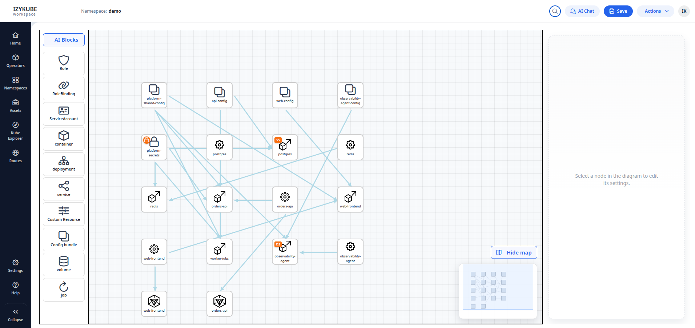

<!--
  IzyKube
  Copyright (c) 2026-present Izylife Solutions s.r.l.
  Author: Giuseppe Cassata

  This program is free software: you can redistribute it and/or modify
  it under the terms of the GNU Affero General Public License as published
  by the Free Software Foundation, either version 3 of the License,
  or (at your option) any later version.

  This program is distributed in the hope that it will be useful,
  but WITHOUT ANY WARRANTY; without even the implied warranty of
  MERCHANTABILITY or FITNESS FOR A PARTICULAR PURPOSE. See the
  GNU Affero General Public License for more details.

  You should have received a copy of the GNU Affero General Public License
  along with this program. If not, see <https://www.gnu.org/licenses/>.
-->

# IzyKube

**Design supported Kubernetes namespace resources visually. Export YAML or Helm artifacts for review in your existing Git workflow.**

IzyKube is a self-hosted visual modeler for small platform teams and Kubernetes consultancies. It complements kubectl, Helm, and existing delivery tools; it is not a replacement for them.

[Product page](https://izykube.izylifesolutions.com/) · [Capability evidence matrix](docs/product/capability-evidence-matrix.md) · [Releases](https://github.com/gcassata74/izykube/releases) · [Docker image](https://hub.docker.com/r/gcassata/izykube)

## What it helps with

- Model supported Kubernetes workloads and their relationships visually.
- Generate YAML or a Helm archive for supported resource types.
- Model supported Kubernetes RBAC policies and Istio VirtualService resources.
- Carry the generated artifacts into your team's existing Git review and deployment process.

## Capability scope

The repository's [capability evidence matrix](docs/product/capability-evidence-matrix.md) distinguishes implemented, partial, planned, and external capabilities. Its audit identifies a 2026-07-12 repository baseline; check that date before treating it as a current assessment.

At that baseline, automated tests cover visual namespace modeling, YAML and Helm export for supported resource types, RBAC manifest generation, and Istio VirtualService export. Cluster apply/undeploy, runtime inspection, and local-AI integration are partial. Comprehensive drift detection, one-click rollback, and production readiness are not established by the cited evidence.

## Development environment

Clone the repository:

~~~bash
git clone https://github.com/gcassata74/izykube.git
cd izykube
~~~

### Prerequisites

- Docker Engine with Docker Compose v2
- Terraform 1.6+
- Java 21
- Node.js 18+ and npm
- kubectl and Helm

### Configured local stack

From the repository root:

~~~bash
make init
make apply
make app
~~~

The apply target provisions the local k3s cluster and configured addons. The current Compose file also expects the generated .izykube kubeconfig, an external Docker network, and pre-existing external MongoDB and Ollama data volumes. The Compose file uses fixed external volume names, and Terraform does not create those data volumes. Therefore a fresh Docker host may require adapting the Compose volume definitions or creating the expected volumes before the app target can start. This sequence describes the configured development environment; it is not yet plug-and-play on a fresh Docker host.

To tear down the configured cluster and addons:

~~~bash
make destroy
~~~

### Frontend development

~~~bash
npm -C frontend install --legacy-peer-deps
npm -C frontend start
~~~

The Angular development server is available at http://localhost:4200.

## Build

Build the packaged application from the repository root:

~~~bash
./mvnw -B -ntp package
~~~

Build only the frontend:

~~~bash
npm -C frontend run build -- --configuration production
~~~

## Repository layout

- frontend/ — Angular application
- backend/ — Spring Boot API and Kubernetes integrations
- terraform/ — local Docker network, registry, k3s cluster, and configured addons
- yaml/ — Kubernetes manifests used by setup flows
- docs/ — GitHub Pages product site and product evidence
- .github/workflows/ — CI and release pipelines

## Docker image

Pull the published image:

~~~bash
docker pull gcassata/izykube:latest
~~~

The latest and commit-SHA tags are published from successful pushes to main. Versioned tags are published for GitHub releases.

## License

IzyKube is distributed under the GNU Affero General Public License v3.0 or later. See [LICENSE.md](LICENSE.md).
